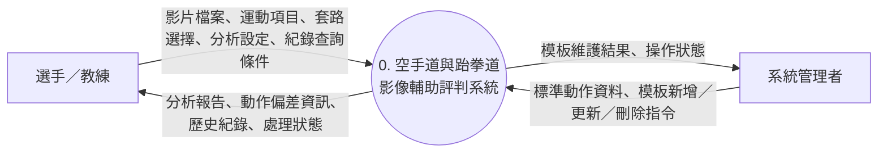
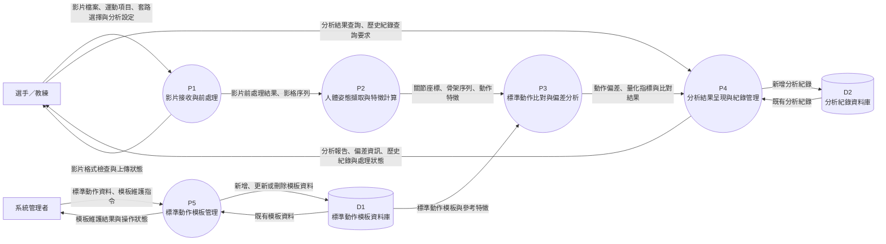

# 小組作業：系統環境圖與資料流程圖（DFD）

- **專題名稱**：基於人體姿態估計之空手道與跆拳道影像輔助評判系統

---

## 1. 系統環境圖（System Context Diagram）

### (1) 圖形說明

系統環境圖將整個影像輔助評判系統視為單一程序，呈現系統與外部實體之間的資料交換。

本系統主要涉及以下外部實體：

1. **選手／教練**：上傳空手道或跆拳道影片、選擇標準動作模板、執行動作分析，以及查詢分析結果與歷史紀錄。
2. **系統管理者**：管理標準動作模板，並接收模板新增、更新或其他維護操作的處理結果。

### (2) 系統環境圖

---

## 2. DFD 圖 0（Level-0 Data Flow Diagram）

### (1) 程序與資料儲存說明

DFD 圖 0 將整個系統進一步分解為五個主要程序：

| 程序編號 | 程序名稱 | 主要功能 |
|---|---|---|
| P1 | 影片接收與前處理 | 接收影片、檢查格式、擷取影格及進行前處理。 |
| P2 | 人體姿態擷取與特徵計算 | 擷取人體關節位置、建立骨架序列，並計算動作特徵。 |
| P3 | 標準動作比對與偏差分析 | 比較選手動作與標準模板，分析姿勢及時序差異。 |
| P4 | 分析結果呈現與紀錄管理 | 整理分析報告、儲存分析紀錄及提供歷史資料查詢。 |
| P5 | 標準動作模板管理 | 新增、更新、刪除及維護標準動作模板。 |

資料儲存項目如下：

| 資料儲存編號 | 名稱 | 儲存內容 |
|---|---|---|
| D1 | 標準動作模板資料庫 | 運動項目、套路名稱、標準骨架序列及動作特徵等資料。 |
| D2 | 分析紀錄資料庫 | 分析日期、運動項目、分析結果、偏差資訊及相關紀錄。 |

### (2) DFD 圖 0

---
