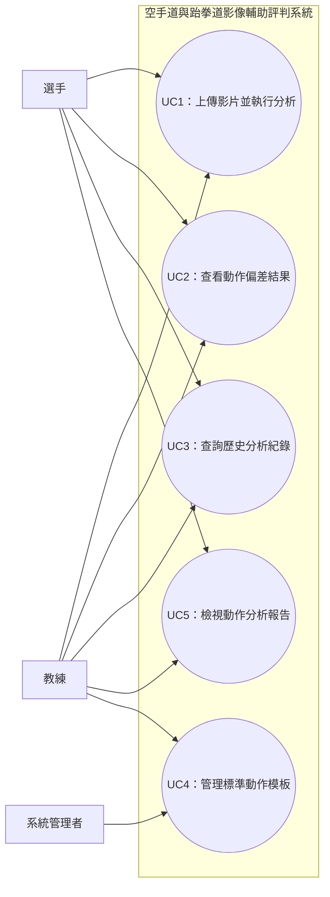

# 小組作業 3：需求分析與系統架構設計

- **專題名稱**：基於人體姿態估計之空手道與跆拳道影像輔助評判系統

---

## 1. 系統需求分析

### (1) 功能性需求（Functional Requirements）

1. **影片上傳與前處理**：系統須允許使用者上傳符合格式與長度限制的空手道或跆拳道套路影片，並進行影片讀取、影格擷取及必要的前處理，供後續分析使用。
2. **人體姿態擷取與特徵計算**：系統須透過人體姿態估計技術擷取選手的主要關節位置，計算關節角度、身體姿勢及其他可量化的動作特徵。
3. **標準動作比對與偏差分析**：系統須將選手影片擷取的動作特徵與已建立的標準動作模板進行比對，分析可能存在的姿勢偏差、動作順序或時序差異。
4. **分析結果視覺化**：系統須以圖像、骨架標記、時間戳記或數據圖表呈現分析結果，協助使用者定位可能需要改善的動作。
5. **分析紀錄與結果查詢**：系統須保存分析結果及相關資訊，讓使用者能查詢先前的分析紀錄，並查看各次分析的偏差項目。
6. **標準動作模板管理**：系統須提供標準動作模板的建立或匯入功能，並記錄模板所屬運動項目及套路名稱，以供分析時選擇與比對。

### (2) 非功能性需求（Non-Functional Requirements）

1. **效能與回應時間**：系統須能在合理時間內完成支援範圍內的影片分析，並顯示處理進度或分析狀態。實際可接受的分析時間應透過測試訂定。
2. **易用性**：系統介面須提供清楚的影片上傳、運動項目選擇、分析執行及結果查詢流程，並以易於理解的方式呈現分析結果。
3. **分析可靠性**：系統須處理影片格式錯誤、影片無法讀取、人體姿態擷取失敗等情況，並提示使用者原因，避免產生未經確認的分析結果。
4. **資料安全與隱私**：系統須限制分析紀錄及影片的存取權限，避免未經授權的人員查看或下載選手影片，並妥善處理影片及相關個人資料。
5. **可維護性與擴充性**：系統各功能模組須盡可能獨立設計，以利後續新增套路模板、調整分析指標或擴充其他運動項目。
6. **可解釋性**：系統須提供可理解的偏差資訊，例如偏差發生的時間、涉及的關節或姿勢特徵，避免只輸出無法解釋的總分。

---

## 2. 功能分解圖（Functional Decomposition Diagram, FDD）

```mermaid
flowchart TD
    Root["空手道與跆拳道影像輔助評判系統"]

    Root --> M1["1. 影片管理"]
    M1 --> M1_1["1.1 上傳影片"]
    M1 --> M1_2["1.2 檢查影片格式"]
    M1 --> M1_3["1.3 影片前處理"]

    Root --> M2["2. 人體姿態分析"]
    M2 --> M2_1["2.1 人體姿態擷取"]
    M2 --> M2_2["2.2 Skeleton正規化"]
    M2 --> M2_3["2.3 動作特徵計算"]

    Root --> M3["3. 標準動作比對"]
    M3 --> M3_1["3.1 選擇標準動作模板"]
    M3 --> M3_2["3.2 動作時序對齊"]
    M3 --> M3_3["3.3 動作偏差分析"]

    Root --> M4["4. 分析結果呈現"]
    M4 --> M4_1["4.1 骨架與偏差標記"]
    M4 --> M4_2["4.2 分析數據與圖表"]
    M4 --> M4_3["4.3 分析結果摘要"]

    Root --> M5["5. 分析紀錄管理"]
    M5 --> M5_1["5.1 儲存分析結果"]
    M5 --> M5_2["5.2 查詢歷史紀錄"]
    M5 --> M5_3["5.3 查看個別分析"]

    Root --> M6["6. 標準模板管理"]
    M6 --> M6_1["6.1 建立或匯入模板"]
    M6 --> M6_2["6.2 管理運動項目"]
    M6 --> M6_3["6.3 管理套路名稱"]
```

---

## 3. 使用案例圖（Use Case Diagram）

---

## 4. 使用案例說明

### 使用案例 1：上傳影片並執行分析（UC1）

**主要參與者：** 選手、教練

**簡要說明：**

使用者上傳空手道或跆拳道套路影片，選擇對應的運動項目及標準動作模板，系統執行人體姿態擷取、動作特徵計算與標準動作比對。

**前置條件：**

- 使用者可以進入系統的影片分析功能。
- 系統已有可供選擇的標準動作模板。
- 使用者提供的影片符合系統支援的格式與分析範圍。

**基本流程：**

1. 使用者進入影片分析頁面。
2. 使用者上傳空手道或跆拳道套路影片。
3. 系統檢查影片格式、長度及檔案是否可正常讀取。
4. 使用者選擇運動項目、套路名稱及對應的標準動作模板。
5. 使用者確認分析設定並啟動分析。
6. 系統擷取影片中的人體姿態，計算關節位置與動作特徵。
7. 系統將分析結果與標準動作模板進行比對。
8. 系統儲存分析結果，並通知使用者分析完成。

**例外流程：**

- 若影片格式不支援或檔案損毀，系統提示使用者重新上傳。
- 若無對應的標準動作模板，系統提示使用者選擇其他已支援的套路。
- 若影片中的人體姿態無法有效擷取，系統提示使用者檢查拍攝角度、畫面清晰度或重新提供影片。

**後置條件：**

系統完成影片分析，並產生可供查詢的分析結果；若分析失敗，則顯示失敗原因。

---

### 使用案例 2：查看動作偏差結果（UC2）

**主要參與者：** 選手、教練

**簡要說明：**

使用者查看影片分析結果，了解選手在特定時間點的姿勢、關節角度或動作時序與標準模板之間的差異。

**前置條件：**

- 系統已完成該影片的分析。
- 分析結果中存在可供呈現的動作特徵及比對資訊。

**基本流程：**

1. 使用者開啟已完成的影片分析結果。
2. 系統顯示影片基本資訊及整體分析摘要。
3. 使用者選擇欲查看的動作階段或偏差項目。
4. 系統顯示對應時間點的影片畫面與人體骨架標記。
5. 系統呈現相關關節角度、姿勢特徵或時序差異。
6. 使用者依據分析資訊，確認需要進一步練習或檢查的動作。

**例外流程：**

- 若部分影格的姿態擷取信心不足，系統標示該部分資料可能不可靠。
- 若特定動作無法與標準模板有效對齊，系統提示該項目無法完成可靠比對。

**後置條件：**

使用者取得該次分析的偏差資訊，且可返回結果摘要或切換其他動作階段。

---

### 使用案例 3：查詢歷史分析紀錄（UC3）

**主要參與者：** 選手、教練

**簡要說明：**

使用者查詢先前的影片分析紀錄，查看過去各次分析的結果，以了解動作表現的變化。

**前置條件：**

- 使用者具有查詢相關分析紀錄的權限。
- 系統已儲存至少一筆分析紀錄。

**基本流程：**

1. 使用者進入歷史分析紀錄頁面。
2. 系統列出可查詢的分析紀錄，包括分析日期、運動項目、套路名稱及分析狀態。
3. 使用者選擇特定的分析紀錄。
4. 系統載入該次分析的摘要與偏差項目。
5. 使用者檢視分析結果，並可進一步開啟詳細的動作偏差畫面。
6. 使用者返回紀錄列表或選擇其他分析紀錄。

**例外流程：**

- 若目前沒有分析紀錄，系統顯示尚無可查詢的資料。
- 若紀錄已刪除或無法讀取，系統提示使用者並返回紀錄列表。

**後置條件：**

使用者完成歷史分析紀錄查詢；系統不會因單純查詢而修改原有分析資料。

---

### 使用案例 4：管理標準動作模板（UC4）

**主要參與者：** 教練、系統管理者

**簡要說明：**

具有相應權限的使用者建立或匯入標準動作模板，並維護模板所屬的運動項目及套路資訊，供影片分析時使用。

**前置條件：**

- 使用者具有標準動作模板的管理權限。
- 使用者提供符合系統要求的標準動作資料或參考影片。

**基本流程：**

1. 使用者進入標準動作模板管理頁面。
2. 使用者選擇新增或匯入標準動作模板。
3. 使用者指定運動項目、套路名稱及相關說明。
4. 系統檢查輸入資料是否符合格式與基本完整性要求。
5. 系統處理標準動作資料，建立可供比對的動作特徵或模板。
6. 系統儲存模板及其相關資訊。
7. 系統顯示新增或更新成功的訊息。

**例外流程：**

- 若資料格式錯誤或必要資訊缺漏，系統提示使用者修正。
- 若模板建立失敗，系統顯示錯誤原因，且不將未完成的模板設為可用。

**後置條件：**

新增或更新的標準動作模板可供後續影片分析使用；若操作失敗，既有有效模板不應受到影響。

---

### 使用案例 5：檢視動作分析報告（UC5）

**主要參與者：** 選手、教練

**簡要說明：**

使用者查看系統彙整的分析報告，掌握本次影片中主要的動作偏差、量化特徵及可能需要改善的項目。

**前置條件：**

- 系統已完成影片分析。
- 系統已產生可供呈現的分析摘要與相關數據。

**基本流程：**

1. 使用者開啟指定的分析報告。
2. 系統顯示運動項目、套路名稱及分析日期。
3. 系統呈現已支援的量化分析結果，例如關節角度差異、姿勢偏差或動作時序差異。
4. 系統列出值得進一步檢查的動作階段及對應時間點。
5. 使用者選擇特定項目，查看更詳細的影像標記與分析資訊。
6. 使用者根據報告結果，作為後續訓練或人工評估的參考。

**例外流程：**

- 若分析資料不足，系統顯示可用的部分結果，並標示無法分析的項目。
- 若分析報告不存在，系統提示使用者重新執行分析或返回紀錄列表。

**後置條件：**

使用者取得該次動作分析報告，作為訓練改善與輔助評估的參考；報告不直接取代正式裁判的評分。

---

## 5. 系統範圍與限制

1. 系統以人體姿態估計、動作特徵計算及標準動作比對為主要技術，不保證能完整判斷所有競賽規則或裁判評分因素。
2. 系統初期以已建立標準動作模板的套路為分析範圍，未支援的套路不保證能提供有效分析。
3. 系統輸出的偏差資訊與量化數據，主要作為選手、教練及相關人員的輔助參考。
4. 空手道與跆拳道的評判規則及技術要求不同，後續應依各運動項目的實際需求設計相應的分析指標。
5. 分析結果的可靠程度須透過實驗及專家意見進行評估，不應直接將系統計算結果視為正式比賽分數。
