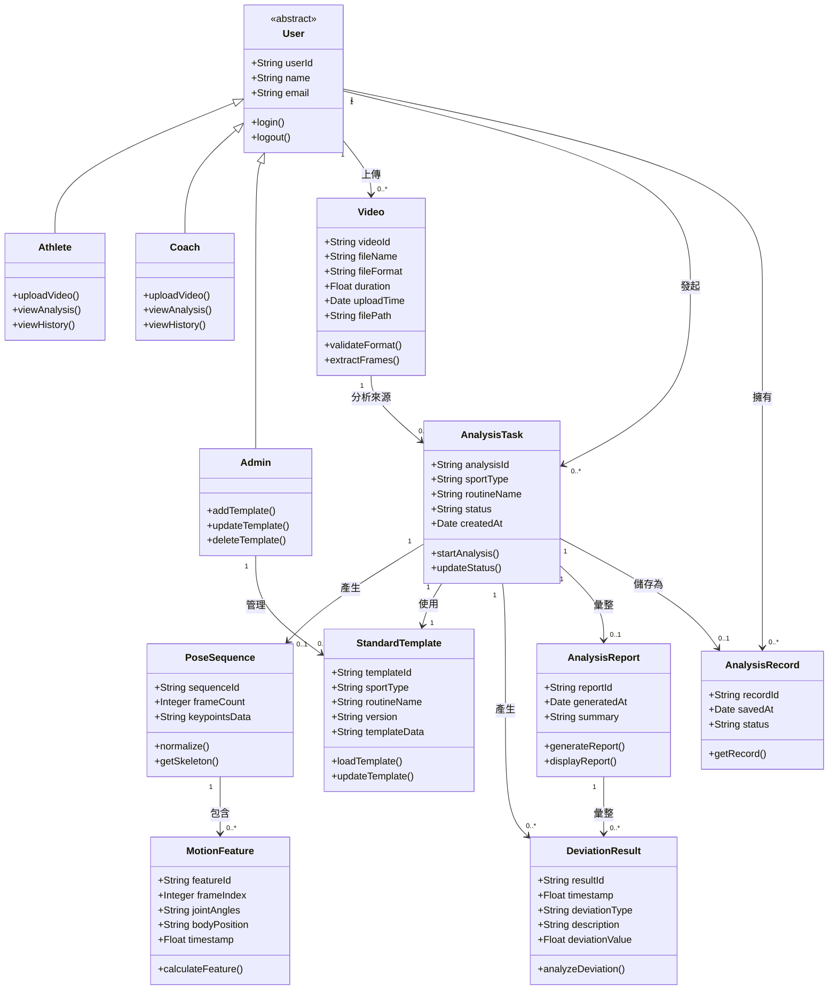
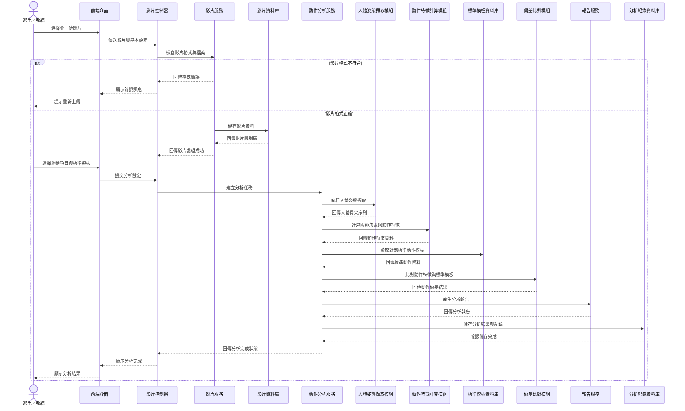
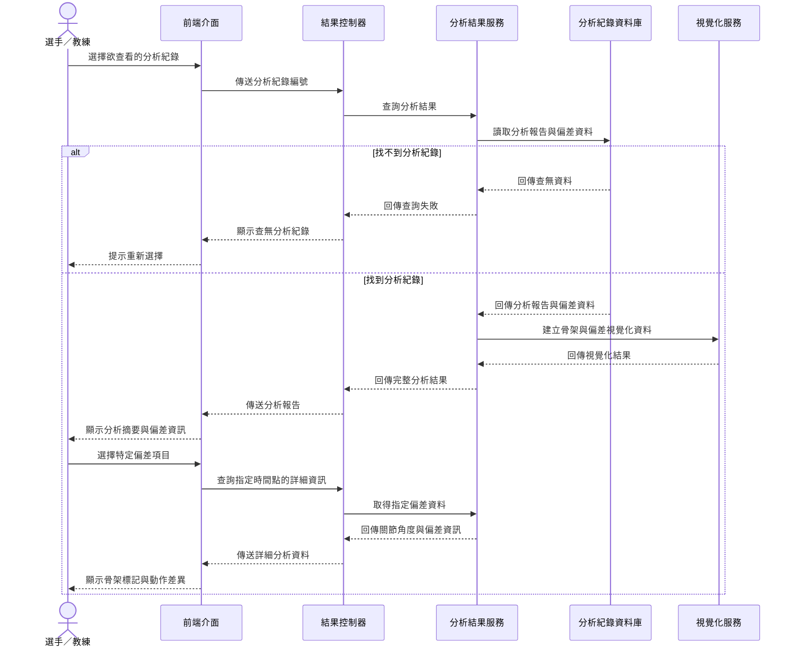
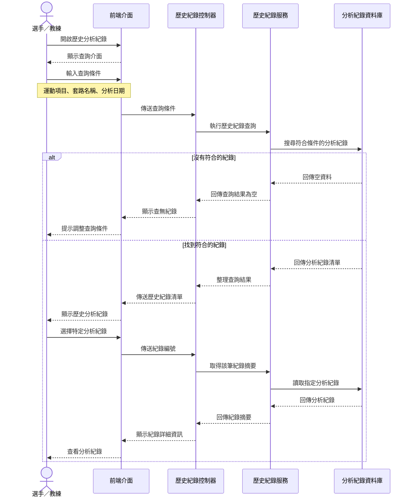
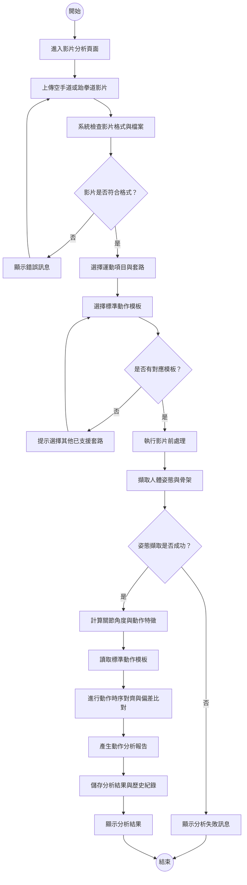
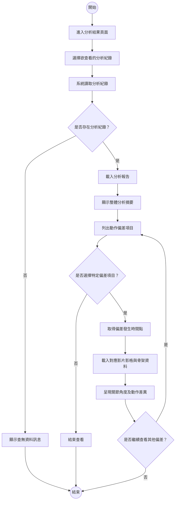
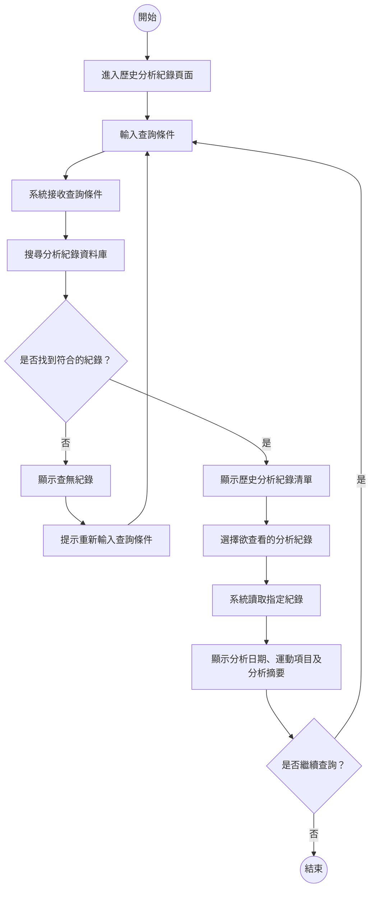

# 小組作業：UML 系統設計

- **專題名稱**：基於人體姿態估計之空手道與跆拳道影像輔助評判系統
- **繳交日期**：2026/11/17

---

# 1. UML 類別圖（Class Diagram）

## (1) 類別說明

本系統主要分為使用者管理、影片管理、動作分析、標準模板管理及分析結果管理等類別。

| 類別名稱 | 主要功能 |
|---|---|
| User | 儲存使用者基本資料及管理使用者身分。 |
| Athlete | 選手角色，可上傳影片及查看分析結果。 |
| Coach | 教練角色，可協助選手分析動作及查看分析紀錄。 |
| Admin | 系統管理者，負責維護標準動作模板。 |
| Video | 管理使用者上傳的影片資料。 |
| AnalysisTask | 管理每次影片分析任務及其執行狀態。 |
| PoseSequence | 儲存人體姿態擷取後的骨架序列資料。 |
| MotionFeature | 儲存關節角度、身體姿勢及動作時序等特徵。 |
| StandardTemplate | 儲存空手道及跆拳道的標準動作模板。 |
| DeviationResult | 儲存選手動作與標準模板比對後的偏差資訊。 |
| AnalysisReport | 彙整每次分析結果，產生視覺化分析報告。 |
| AnalysisRecord | 儲存歷史分析紀錄，供使用者日後查詢。 |

## (2) UML 類別圖

## (3) 類別圖關係說明

1. **繼承關係**：Athlete、Coach、Admin 繼承 User，代表不同使用者角色具有共同的基本資料及登入功能。
2. **影片與分析任務**：一部影片可以建立多次分析任務，例如使用不同的標準動作模板進行比較。
3. **分析任務與人體姿態**：每次分析任務會產生人體骨架序列，並從中計算多項動作特徵。
4. **分析任務與標準模板**：每次分析任務須選擇一個對應的標準動作模板，作為動作比對依據。
5. **分析結果與偏差資訊**：一次分析可能產生多筆動作偏差資訊，最後彙整成分析報告。
6. **歷史紀錄管理**：系統將分析任務結果保存為歷史紀錄，讓使用者日後能夠查詢。

---

# 2. 循序圖（Sequence Diagram）

循序圖主要呈現系統中不同物件之間的互動順序，依照三個主要使用案例進行設計。

## 使用案例一：上傳影片並執行分析（UC1）

### (1) 簡要說明

選手或教練上傳空手道或跆拳道套路影片，選擇對應的運動項目與標準動作模板，系統開始進行影片前處理、人體姿態擷取、動作特徵計算及標準動作比對，最後產生分析結果。

### (2) 循序圖

---

## 使用案例二：查看動作偏差結果（UC2）

### (1) 簡要說明

使用者開啟已完成的影片分析結果，系統載入分析報告及偏差資料，呈現選手在特定時間點的關節角度、人體骨架及動作偏差，協助使用者了解需要改善的動作。

### (2) 循序圖

---

## 使用案例三：查詢歷史分析紀錄（UC3）

### (1) 簡要說明

使用者進入歷史分析紀錄頁面，系統依照使用者提供的查詢條件，例如運動項目、套路名稱或分析日期，搜尋過往的影片分析紀錄，並顯示符合條件的資料。

### (2) 循序圖

---

# 3. 活動圖（Activity Diagram）

活動圖主要呈現使用者與系統在執行各項功能時的活動流程，並透過判斷節點表示不同情況下的處理方式。

## 使用案例一：上傳影片並執行分析（UC1）

### (1) 簡要說明

呈現使用者從上傳影片開始，到系統完成人體姿態擷取、動作特徵計算、標準動作比對及產生分析報告的完整流程。

### (2) 活動圖

---

## 使用案例二：查看動作偏差結果（UC2）

### (1) 簡要說明

呈現使用者開啟分析結果後，系統載入分析報告、顯示偏差項目，並提供特定時間點的骨架與動作差異資訊的流程。

### (2) 活動圖

---

## 使用案例三：查詢歷史分析紀錄（UC3）

### (1) 簡要說明

呈現使用者進入歷史紀錄頁面後，輸入查詢條件、搜尋過往分析紀錄，並查看指定紀錄詳細資訊的流程。

### (2) 活動圖

---

# 4. 圖表與系統設計補充說明

## (1) 類別圖與系統功能的對應

| 系統功能 | 對應類別 |
|---|---|
| 使用者與角色管理 | User、Athlete、Coach、Admin |
| 影片上傳與管理 | Video |
| 影片分析任務 | AnalysisTask |
| 人體姿態擷取 | PoseSequence |
| 動作特徵計算 | MotionFeature |
| 標準動作比對 | StandardTemplate |
| 動作偏差分析 | DeviationResult |
| 分析報告產生 | AnalysisReport |
| 歷史紀錄查詢 | AnalysisRecord |

## (2) 系統核心運作流程

本系統的核心分析流程如下：

1. 使用者上傳空手道或跆拳道影片。
2. 系統進行影片前處理與影格擷取。
3. 使用人體姿態估計技術擷取選手骨架。
4. 計算關節角度、身體姿勢及動作時序等特徵。
5. 與對應的標準動作模板進行比對。
6. 分析可能存在的動作偏差。
7. 產生分析報告並儲存歷史紀錄。
8. 使用者查看分析結果，作為訓練改善與輔助評估的參考。

## (3) 系統設計範圍與限制

1. 系統初期以已建立標準動作模板的空手道及跆拳道套路為分析範圍。
2. 人體姿態估計主要負責擷取關節位置與骨架資訊，無法單獨判斷所有競賽評分項目。
3. 動作比對以可量化的關節角度、姿勢及時序差異為主。
4. 系統提供的分析結果屬於輔助資訊，不直接取代正式裁判的評分。
5. 空手道與跆拳道具有不同的動作特性及評判規則，應依不同運動項目建立對應的標準動作模板及分析指標。
